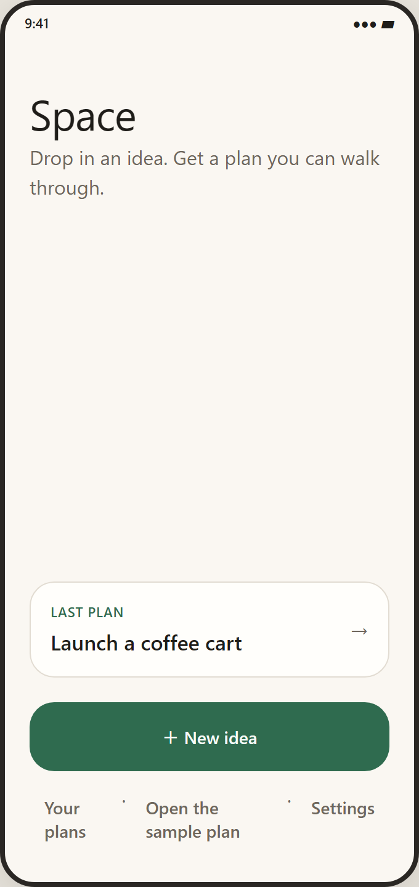
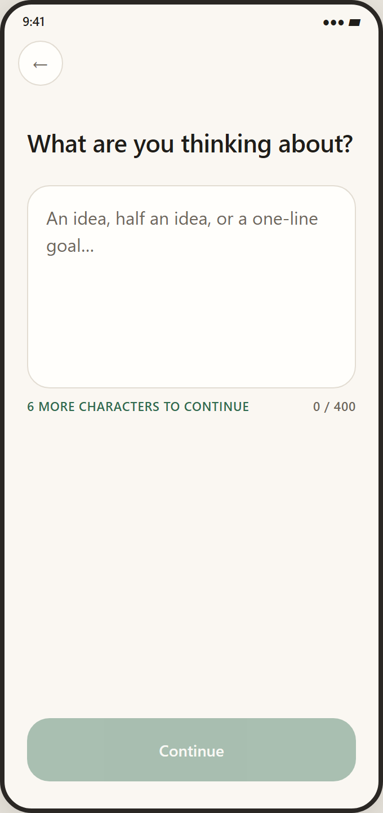
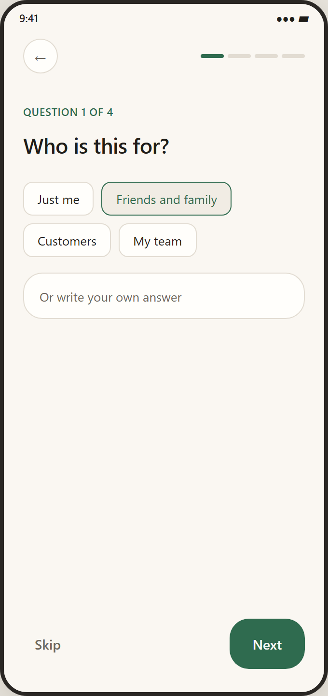
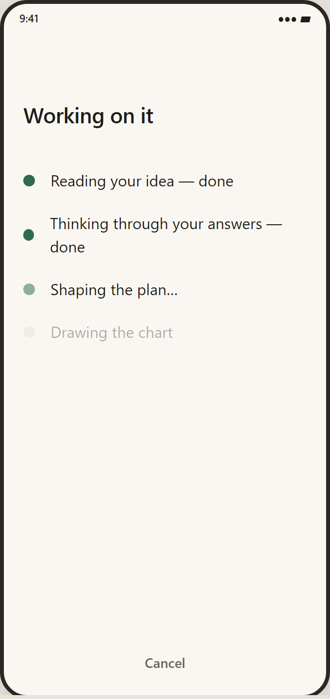
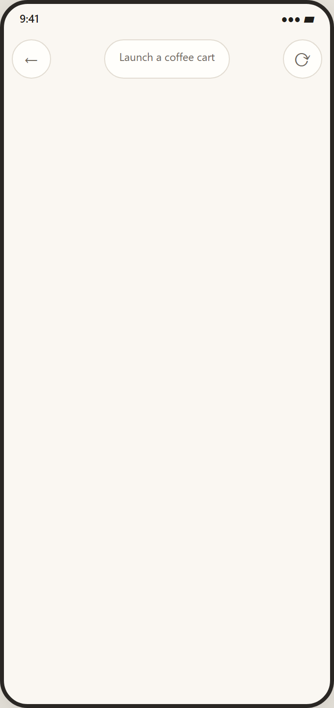
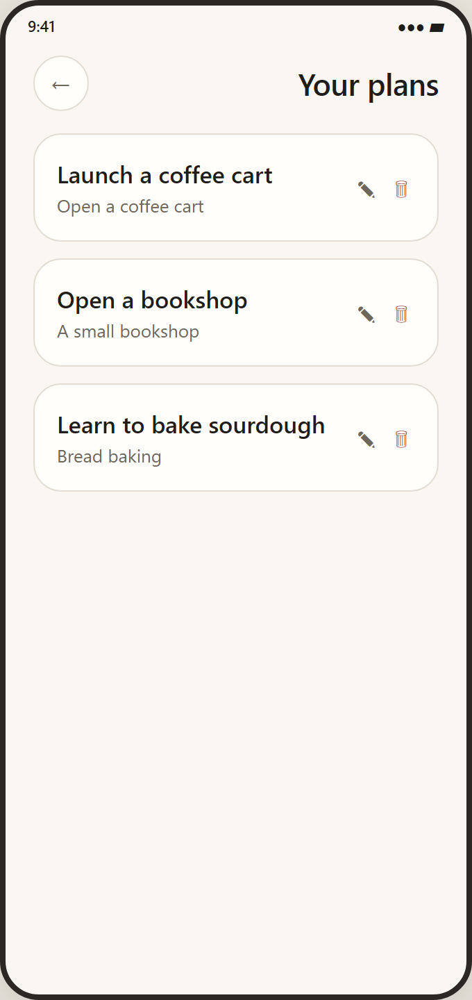
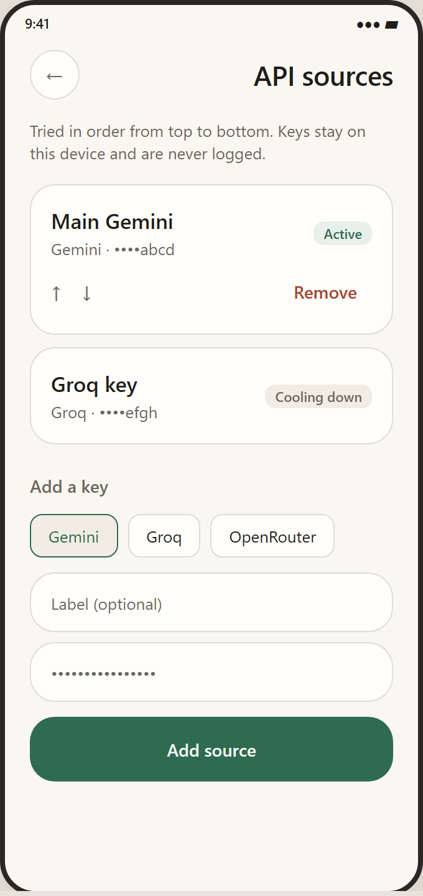

# Space

**Type a rough idea → answer 2–4 sharp questions → watch a flowchart plan assemble itself on screen.**

[](https://kotlinlang.org)
[](https://developer.android.com/jetpack/compose)
[](https://developer.android.com/tools/releases/platforms)
[]()
[](LICENSE)

Android app, Jetpack Compose, single Activity. No DI framework, no backend — everything runs on-device.

---

## The flow

```
Home → Idea → Questions → Generating → Chart (pan / zoom / tap a node for detail)
                       ↘ Library (saved plans)   ↘ Settings (API keys)
```

Every step has a designed loading, error, and empty state. If generation fails
outright, you can fall back to a built-in starter plan and still get a chart.

## AI layer

Two LLM calls share one failover implementation (`domain/generation/FailOverRunner.kt`):

1. **Questions call** — idea in, 2–4 clarifying questions out.
2. **Plan call** — idea plus answers in, strict JSON plan out.

| Condition | Behaviour |
|---|---|
| No keys configured | questions → offline pack, plan → starter plan |
| 401 / 403 | key marked **Invalid**, try next source |
| 429 | key **Cooling** for `Retry-After` (default 60s), try next source |
| 5xx | one retry on the same source, then try next |
| Network / timeout / malformed | short soft-cool (15s), try next |
| 400 | stop — that is a prompt bug, not a key problem |
| All sources cooling/invalid or budget spent | report the reason; offer starter plan |

Malformed model JSON gets one repair retry before failing over. Keys are tried in
Settings priority order; the chain skips any key that is cooling or invalid rather
than hammering it.

**Supported providers:** Google Gemini, Groq, OpenRouter (OpenAI-compatible). Each
is an adapter behind `LlmClient` — none is hard-wired.

## Architecture

`ui → domain → data`, constructor injection only.

| Layer | What's in it |
|---|---|
| `domain/` | Pure Kotlin: models, prompts, JSON decoding, `PlanValidator`, `LayeredLayout`, failover core. JVM-unit-testable. |
| `data/` | `FilePlanStore` (atomic temp-file rename, 50-plan cap), `EncryptedSettingsRepository` (EncryptedSharedPreferences + DataStore), in-memory variants for tests. |
| `ui/` | Compose screens + one `PlanFlowViewModel` holding the whole flow, with injectable seams for tests. |

## Screenshots

| Home | Idea | Questions |
|---|---|---|
|  |  |  |

| Generating | Chart | Library | Settings |
|---|---|---|---|
|  |  |  |  |

## Getting started

### Prerequisites

- Android Studio (latest stable)
- JDK 25+ (JDK 26 recommended)
- Android SDK platform 36

### Build & run

```bash
# clone
git clone https://github.com/Teerth-Sonawani/space.git
cd space

# open in Android Studio, or build from CLI:
./gradlew assembleDebug

# run unit tests (no emulator needed)
./gradlew testDebugUnitTest
```

The app starts without any API keys configured — it uses the offline question
pack and the built-in starter plan until you add a key in Settings.

### API keys

Open **Settings** from the home screen and add a key for any of:

- **Gemini** — [aistudio.google.com/apikey](https://aistudio.google.com/apikey)
- **Groq** — [console.groq.com/keys](https://console.groq.com/keys)
- **OpenRouter** — [openrouter.ai/keys](https://openrouter.ai/keys)

Keys are encrypted with Android Keystore and stored only on-device. They are
never logged or included in backups.

## Tech stack

| Area | Choice |
|---|---|
| UI | Jetpack Compose, Material 3 (custom theme) |
| Navigation | Navigation Compose (string routes) |
| DI | Constructor injection (no framework) |
| Persistence | FilePlanStore (JSON files), DataStore + EncryptedSharedPreferences |
| Networking | OkHttp + kotlinx.serialization |
| Testing | JUnit 4, Robolectric (Compose UI on JVM), MockWebServer |
| Build | Gradle 9.5, AGP 8.13, R8 minification |

## Tests

`app/src/test` — **168 JVM tests**, no emulator needed:

| Suite | What it covers |
|---|---|
| `FailOverRunnerTest`, `ProviderChainTest`, `QuestionsChainTest` | Failover table end to end |
| `HttpFailOverTest`, `KeyHealthStoreTest` | HTTP status mapping, cooldown/invalidation |
| `PlanJsonDecoderTest`, `QuestionsJsonDecoderTest`, `JsonExtractTest` | Model output parsing (fenced/prose-wrapped JSON) |
| `PlanValidatorTest`, `LayeredLayoutTest` | Schema validation, layout determinism |
| `PlanCodecTest`, `FilePlanStoreTest` | Serialization, atomic writes |
| `SamplePlanTest`, `StarterPlanGeneratorTest` | Sample plan validity, starter output |
| `PlanFlowViewModelTest` | Flow state, drafts, library, questions fallback |
| `ProviderIntegrationTest` | HTTP cycle via MockWebServer (success, 401, 429) |
| `HomeScreenUiTest`, `IdeaScreenUiTest`, `QuestionsScreenUiTest`, `GeneratingScreenUiTest`, `ChartScreenUiTest`, `LibraryScreenUiTest`, `SettingsScreenUiTest` | Compose UI via Robolectric |

Not covered: `androidTest` instrumentation tests (need an emulator).

## Project structure

```
app/src/main/java/com/space/app/
├── MainActivity.kt
├── data/                  # storage, settings, providers metadata
├── domain/
│   ├── generation/        # LLM clients, prompts, failover, JSON decoders
│   ├── layout/            # layered top-to-bottom chart layout
│   ├── model/             # Plan, Node, Edge, IdeaBrief, ClarifyingQuestion
│   ├── sample/            # hardcoded sample plan
│   └── validation/        # PlanValidator
└── ui/
    ├── screens/           # Home, Idea, Questions, Generating, Chart, Library, Settings
    ├── theme/             # colors, type, shapes
    ├── Motion.kt          # reduced-motion detection
    └── PlanFlowViewModel.kt
```

## Contributing

See [CONTRIBUTING.md](CONTRIBUTING.md) for guidelines.

## Changelog

See [CHANGELOG.md](CHANGELOG.md) for release notes.

## License

MIT — see [LICENSE](LICENSE).

## Acknowledgements

- [Jetpack Compose](https://developer.android.com/jetpack/compose) for the UI toolkit
- [OkHttp](https://square.github.io/okhttp/) for networking
- [kotlinx.serialization](https://github.com/Kotlin/kotlinx.serialization) for JSON